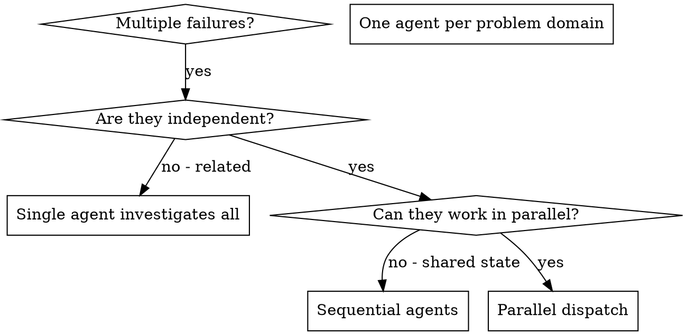

# Параллельное привлечение агентов

## Приоритет правил проекта

В проектах Валерия соблюдай СУИИР, его поручение и ограничения среды. Привлекай субагентов только если делегирование разрешено и полезно для задачи; иначе самостоятельно выполни и проверь работу. Независимость задач сама по себе не разрешает запуск субагентов.

## Обзор

Ты делегируешь задачи специализированным агентам с изолированным контекстом. Точные инструкции и необходимый контекст помогают им сосредоточиться и выполнить задачу. Они не должны наследовать контекст или историю твоей сессии: передавай только то, что им нужно. Так ты также сохраняешь собственный контекст для координации.

Когда есть несколько не связанных между собой сбоев — в разных тестовых файлах, подсистемах или ошибках, — последовательное расследование тратит время. Независимые проблемы можно исследовать параллельно.

**Главный принцип:** привлекай по одному агенту на каждую независимую область проблемы. Пусть они работают одновременно.

## Когда применять



**Применяй, когда:**
- В трёх и более тестовых файлах сбои с разными первопричинами.
- Несколько подсистем сломались независимо друг от друга.
- Каждую проблему можно понять без контекста остальных.
- У расследований нет общего изменяемого состояния.

**Не применяй, когда:**
- Сбои связаны: исправление одного может устранить остальные.
- Необходимо сначала понять состояние всей системы.
- Агенты будут мешать друг другу.

## Порядок работы

### 1. Определи независимые области

Сгруппируй сбои по тому, что сломалось:
- Тесты файла A: согласование инструментов.
- Тесты файла B: завершение пакета.
- Тесты файла C: прерывание.

Это независимые области: исправление согласования не влияет на тесты прерывания.

### 2. Подготовь конкретные задачи агентам

Каждому агенту нужны:
- **Конкретные границы:** один тестовый файл или подсистема.
- **Ясная цель:** добиться прохождения указанных тестов.
- **Ограничения:** не менять посторонний код.
- **Ожидаемый результат:** кратко сообщить, что найдено и исправлено.

### 3. Запусти параллельно

Вызови всех трёх субагентов в одном ответе — они будут работать параллельно:

```text
Subagent (general-purpose): "Fix agent-tool-abort.test.ts failures"
Subagent (general-purpose): "Fix batch-completion-behavior.test.ts failures"
Subagent (general-purpose): "Fix tool-approval-race-conditions.test.ts failures"
# All three run concurrently.
```

Несколько вызовов в одном ответе означают параллельное выполнение; по одному вызову на ответ — последовательное.

### 4. Проверь и объедини результаты

Когда агенты вернутся:
- Прочитай каждую сводку.
- Убедись, что исправления не конфликтуют.
- Запусти полный набор тестов.
- Объедини все изменения.

## Структура задания агенту

Хорошее задание:
1. **Сфокусировано:** одна понятная область проблемы.
2. **Самодостаточно:** содержит весь контекст, нужный для понимания.
3. **Определяет результат:** что именно агент должен вернуть?

```markdown
Исправь три упавших теста в src/agents/agent-tool-abort.test.ts:

1. "should abort tool with partial output capture" — ожидает 'interrupted at' в сообщении
2. "should handle mixed completed and aborted tools" — быстрый инструмент прерывается вместо завершения
3. "should properly track pendingToolCount" — ожидает три результата, но получает ноль

Это проблемы времени и состояния гонки. Твоя задача:

1. Прочитай файл тестов и пойми, что проверяет каждый тест
2. Определи первопричину: проблема времени или реальные ошибки?
3. Исправь:
   - Замени произвольные таймауты ожиданием события
   - Исправь найденные ошибки реализации прерывания
   - Скорректируй ожидания тестов, если проверяемое поведение изменилось

НЕ ограничивайся увеличением таймаутов — найди настоящую проблему.

Верни: краткое описание того, что ты нашёл и исправил.
```

## Типичные ошибки

**❌ Слишком широко:** «Исправь все тесты» — агент потеряет фокус.
**✅ Конкретно:** «Исправь agent-tool-abort.test.ts» — границы понятны.

**❌ Без контекста:** «Исправь состояние гонки» — агент не знает где.
**✅ С контекстом:** приложи сообщения об ошибках и названия тестов.

**❌ Без ограничений:** агент может начать перерабатывать всё подряд.
**✅ С ограничениями:** «НЕ меняй production-код» или «Исправляй только тесты».

**❌ Неясный результат:** «Исправь это» — непонятно, что изменилось.
**✅ Конкретный результат:** «Верни сводку первопричины и изменений».

## Когда НЕ применять

**Связанные сбои:** одно исправление может устранить остальные — сначала исследуй их вместе.
**Нужен полный контекст:** для понимания необходимо видеть всю систему.
**Поисковая отладка:** ещё неизвестно, что сломалось.
**Общее состояние:** агенты помешают друг другу, например при редактировании одних файлов или использовании одних ресурсов.

## Реальный пример из сессии

**Ситуация:** шесть упавших тестов в трёх файлах после крупного рефакторинга.

**Сбои:**
- agent-tool-abort.test.ts: три ошибки, связанные со временем.
- batch-completion-behavior.test.ts: две ошибки, инструменты не выполняются.
- tool-approval-race-conditions.test.ts: одна ошибка, число выполнений = 0.

**Решение:** области независимы: логика прерывания отделена от пакетного завершения и состояния гонки.

**Распределение:**
```text
Agent 1 → Fix agent-tool-abort.test.ts
Agent 2 → Fix batch-completion-behavior.test.ts
Agent 3 → Fix tool-approval-race-conditions.test.ts
```

**Результаты:**
- Агент 1 заменил таймауты ожиданием события.
- Агент 2 исправил структуру события: threadId находился не там.
- Агент 3 добавил ожидание завершения асинхронного инструмента.

**Объединение:** исправления независимы, конфликтов нет, полный набор тестов проходит.

## Проверка

Когда агенты вернутся:
1. **Изучи каждую сводку:** пойми, что изменилось.
2. **Проверь конфликты:** не меняли ли агенты один код?
3. **Запусти полный набор тестов:** убедись, что исправления работают вместе.
4. **Проверь выборочно:** агенты могут систематически ошибаться.
