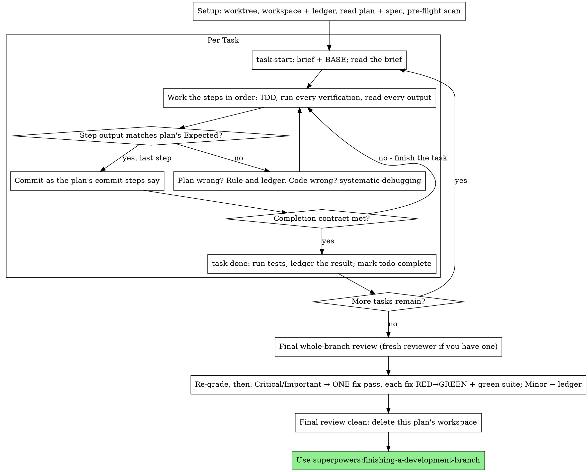

# Выполнение планов

## Приоритет СУИИР и указаний пользователя

В проектах Валерия СУИИР и прямые указания пользователя имеют приоритет. Выполняй уже разрешённую работу, не запрашивая подтверждение повторно. Защищай существующие пользовательские данные и рабочий код: удаление, публикацию и другие действия согласовывай в случаях, требуемых СУИИР и инструкциями пользователя.

Выполняй план самостоятельно, задача за задачей, в этой сессии: без отдельного субагента-исполнителя и проверяющего для каждой задачи. В конце проведи одну проверку всей ветки со свежим контекстом.

**Почему выполнение в текущей сессии:** при разработке через субагентов каждую задачу выполняет новый исполнитель и проверяет новый ревьюер, каждый заново изучает проект. Здесь используется один контекст исполнителя и один проверяющий в конце. Цена экономии — отсутствие свежего контекста и второго взгляда на каждом этапе. Навык компенсирует это: краткое задание опирается на спецификацию, журнал хранит ход работы, TDD проверяет каждую задачу, а итоговый ревьюер даёт второй взгляд.

**Главный принцип:** решения уже приняты в плане. Выполняй его точно, подтверждай шаги тестом, который видел падающим и затем проходящим, и оставляй записи, не зависящие от памяти сессии.

**Сообщения по ходу:** между вызовами инструментов давай не более одной короткой строки: журнал и результаты инструментов сохраняют детали.

**Непрерывное выполнение:** не останавливайся между задачами, чтобы спросить пользователя, продолжать ли. Он выбрал самостоятельное выполнение, чтобы снизить расходы, а не отвечать после каждой задачи. Выполни все задачи плана.

**Принимай решения вместо остановки.** Разбирай противоречия, неоднозначности и дефекты плана. Спецификация определяет требования, план обосновывает реализацию, а вопросы, на которые не отвечает ни то ни другое, решай по собственному суждению. Каждое решение записывай в журнале в формате `Ruling: <что решил> — <почему> — <цена ошибки>` и продолжай. Отклонение от плана без записи — скрытое решение.

Исходный навык выделяет четыре основания остановиться и спросить: необратимая или разрушительная операция; действие, затрагивающее безопасность; внешнее по отношению к worktree действие, для которого требуется разрешение, например слияние, push в общую ветку или публикация; план настолько сломан, что любой дальнейший шаг будет догадкой. Учитывай разрешения, уже данные пользователем, и правила СУИИР.

## Когда использовать

- Есть план из `superpowers:writing-plans`, и пользователь выбрал выполнение в текущей сессии.
- В среде нет инструмента субагентов — см. справочники платформ в `../using-superpowers/references/`. Не изображай вызов субагента: выполняй план здесь.
- Задачи в основном независимы; то же условие действует для `superpowers:subagent-driven-development`.

Полностью определённый план превращает самостоятельное выполнение в реализацию и тестирование; для него может хватить модели среднего уровня, а наиболее сильная модель особенно полезна для финальной проверки всей ветки. Сообщи это пользователю при выборе способа.

Предпочитай `superpowers:subagent-driven-development`, когда пользователь хочет проверку каждой задачи или план настолько длинный, что к последним задачам контекст будет сжат. Самостоятельное выполнение длинного плана тоже возможно благодаря журналу, но к концу остаётся меньше свежего контекста.

## Процесс

## Подготовка

Обеспечь изолированную рабочую область: через `superpowers:using-git-worktrees` создай её или проверь существующую. Не начинай реализацию в ветке main/master без явного разрешения пользователя.

История разговора не всегда переживает сжатие контекста. Исполнитель, потерявший место в плане, может заново выполнить задачи, коммиты которых уже существуют. Отслеживай ход работы в файле журнала, а не только в списке задач. Список задач показывает текущее состояние; журнал сохраняет историю.

Этот журнал и рабочая область общие с `superpowers:subagent-driven-development`: каталог и формат одинаковы, поэтому другой исполнитель может продолжить план с того же места.

- У каждого плана собственная рабочая область. В начале навыка запусти `../subagent-driven-development/scripts/sdd-workspace PLAN_FILE` по абсолютному пути из используемого рабочего дерева. Команда выведет игнорируемый git каталог плана `<repo-root>/.superpowers/sdd/<plan-basename>/`: там хранятся журнал, краткие задания и пакеты проверки ТОЛЬКО этого плана. Каталог другого плана не читай и не изменяй.
- Проверь журнал этого плана в `<workspace>/progress.md`. Если первая строка указывает на текущий файл плана, задачи со строкой `Task <N>: complete` ЗАВЕРШЕНЫ: не повторяй их, продолжай с первой задачи без такой строки. Коммиты остаются в git, даже если ты их не помнишь; после сжатия контекста опирайся на журнал и `git log`. Если первая строка называет другой план, это чужой журнал: оставь его и создай свой.
- Первая строка нового журнала: `# SDD ledger — plan: <plan file path>`.
- `git clean -fdx` уничтожит рабочую область, потому что она игнорируется git. Если это произошло, восстанавливай сведения по `git log`.

Один раз прочитай план, отметь его контекст и Global Constraints и создай задачу в списке для каждого пункта. Если план ссылается на Spec, прочитай и её: спецификация определяет требования, а противоречия плана разрешаются по ней. Если спецификация недоступна или не указана, отметь это в журнале: решения без неё предварительные.

**ОБЯЗАТЕЛЬНЫЙ НАВЫК:** загрузи `superpowers:test-driven-development` до задачи 1. Он регулирует каждый её шаг и все последующие задачи; наличие в плане фразы «сначала напиши падающий тест» не освобождает от чтения навыка.

Перед задачей 1 проверь план на противоречия между задачами. Блоки Interfaces показывают, где искать: для каждой задачи, использующей результат предыдущей, добавь в журнал строку с номерами задач, производимым и потребляемым интерфейсом и результатом сравнения. Для задач без общих интерфейсов строки не нужны; если ни одна задача ничего не разделяет, запиши `Pre-flight: no shared interfaces`. Каждое противоречие разреши по спецификации, запиши решение рядом и приступай к задаче 1. Текст отдельных задач проверяется при чтении их кратких заданий, а не на этом этапе.

## Выполнение задач и завершение

Обязательно прочитай [task-loop-and-review.md](task-loop-and-review.md): там описаны порядок выполнения каждой задачи, критерии завершения, итоговая проверка, запись решений и типичные ошибки. Соблюдай приоритет СУИИР и указаний пользователя в начале файла.
