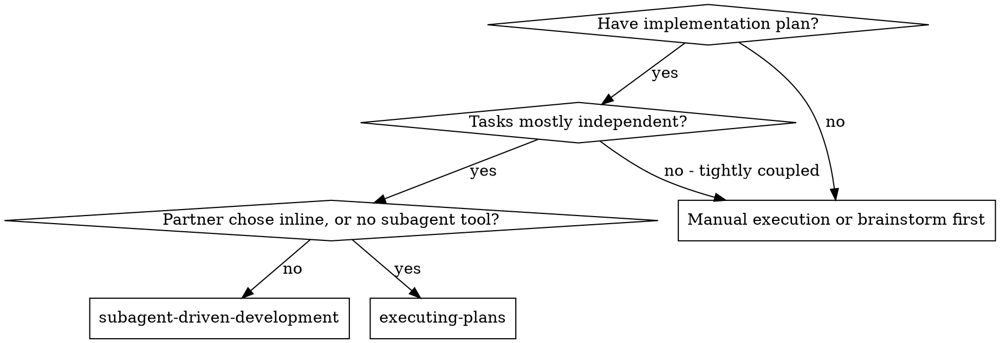
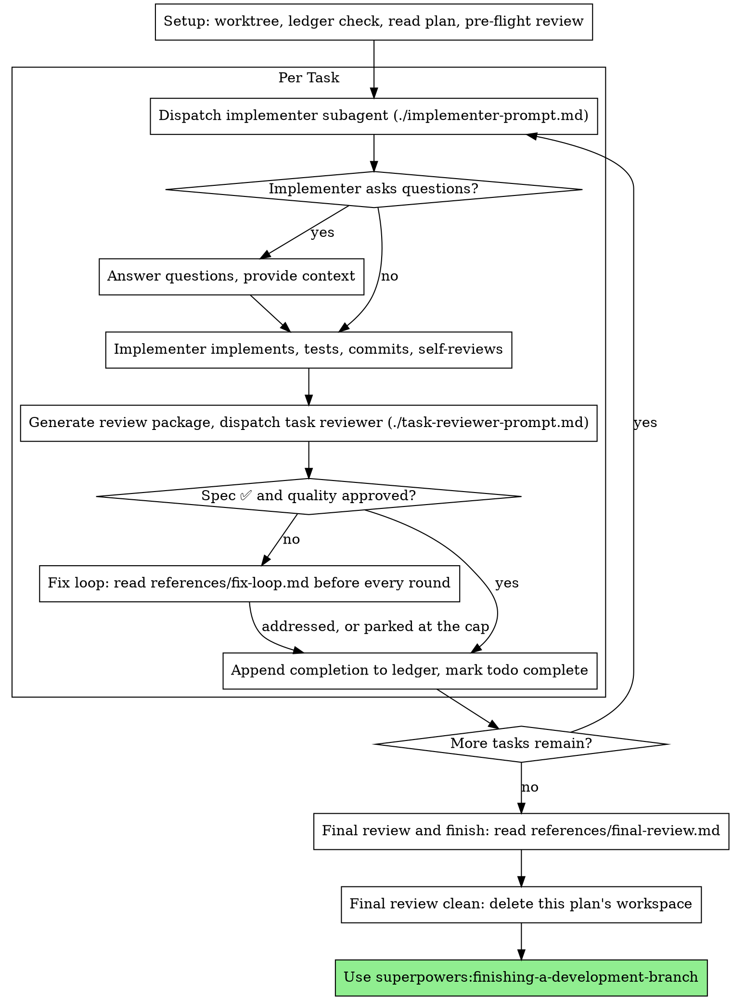

# Разработка с субагентами

## Приоритет правил проекта

В проектах Валерия СУИИР и прямые указания пользователя имеют приоритет. Используй субагентов только когда это разрешено текущими инструкциями и пользовательским поручением. Если пользователь выбрал самостоятельную работу, соблюдай его выбор. Уже разрешённые действия не согласовывай повторно; защищай пользовательские данные и существующий код.

Выполняй план, привлекая для каждой задачи нового субагента-исполнителя, после каждой задачи проверяя соответствие спецификации и качество кода, а в конце — всю ветку целиком.

**Зачем субагенты:** задачи передаются специализированным агентам с изолированным контекстом. Точно подготовленные инструкции позволяют им сосредоточиться. Они не должны наследовать историю текущей сессии: передавай ровно необходимое. Это также сохраняет твой контекст для координации.

**Главный принцип:** новый субагент на задачу + проверка задачи на соответствие и качество + общая итоговая проверка = качественная и быстрая работа.

**Сообщения по ходу:** между вызовами инструментов давай не более одной короткой строки: журнал и результаты инструментов сохраняют подробности.

**Непрерывная работа:** не останавливайся после каждой задачи, чтобы спросить пользователя, продолжать ли. Выполняй все задачи плана. Исходный процесс разрешает остановку только по четырём основаниям ниже либо после выполнения всех задач. Вопросы «продолжать?» и избыточные сводки расходуют время пользователя.

**Принимай обычные решения самостоятельно.** Проверяй план по спецификации и фактам проекта; фиксируй существенные решения и отклонения. При стоп-условиях СУИИР, включая противоречие архитектуре, неизвестного владельца логики или риск для production, останови зависимую работу и обратись к владельцу. Независимые разрешённые задачи продолжай.

Исходный навык выделяет четыре основания остановиться: необратимое или разрушительное действие; действие, затрагивающее безопасность; внешнее по отношению к worktree действие, для которого необходимо разрешение, например слияние, push в общую ветку или публикация; план настолько сломан, что любой путь вперёд будет догадкой. Учитывай разрешения, уже данные пользователем, и правила СУИИР.

## Когда применять

**По сравнению с `executing-plans`:**
- Новый субагент на каждую задачу вместо одного общего контекста.
- Проверка соответствия спецификации и качества после каждой задачи вместо проверки только в конце.
- Отдельный контекст исполнителя и ревьюера для каждой задачи расходует больше ресурсов; при самостоятельной работе нужен один контекст и один финальный проверяющий.
- Оба подхода выполняются в текущей сессии, используют общую рабочую область и журнал плана и не требуют остановок между задачами.

## Процесс

## Подготовка

Работай в изолированной области: создай её или проверь существующую с помощью `superpowers:using-git-worktrees`. Не начинай реализацию в main/master без явного разрешения пользователя.

История разговора не всегда переживает сжатие контекста. В реальных сессиях координаторы, потерявшие место, повторно запускали целые последовательности уже завершённых задач — это один из самых дорогих сбоев. Веди журнал прогресса, а не только список задач.

- Для каждого плана есть собственная рабочая область. В начале запусти `bash scripts/sdd-workspace PLAN_FILE` этого навыка по абсолютному пути из рабочего дерева. Скрипт покажет каталог, игнорируемый git, внутри `<repo-root>/.superpowers/sdd/`: в нём лежат журнал, задания, отчёты и пакеты проверки ЭТОГО плана. Не читай и не изменяй каталог другого плана.
- Проверь `<workspace>/progress.md`. Если журнал существует, сначала прочитай [references/resuming.md](references/resuming.md): там описано, кому принадлежит журнал и с какого места продолжить.
- Первая строка нового журнала: `# SDD ledger — plan: <plan file path>`.
- Журнал — карта восстановления: его коммиты остаются в git, даже когда ты не помнишь, как их создал. После сжатия контекста доверяй журналу и `git log`, а не воспоминаниям.
- `git clean -fdx` уничтожит рабочую область, так как она игнорируется git. Если это произошло, восстанавливай сведения по `git log`.

Один раз прочитай план, отметь контекст и Global Constraints и создай задачу на каждый пункт. Если план указывает Spec, прочитай и её: спецификация определяет требования и разрешает противоречия плана. Если спецификация недоступна или не указана, отметь это в журнале: решения без неё предварительны.

До запуска задачи 1 прочитай [references/preflight.md](references/preflight.md) и проверь противоречия согласно инструкции. Таблицу и принятые решения запиши в журнал.

## Выбор модели

Для каждой роли выбирай наименее мощную модель, которая справится с работой, если выбор моделей разрешён средой.

- **Механическая реализация:** отдельные функции, ясная спецификация, 1–2 файла — быстрая недорогая модель. При хорошем плане таких задач большинство.
- **Интеграция и суждение:** координация нескольких файлов, сопоставление подходов, отладка — стандартная модель.
- **Архитектура и проектирование:** наиболее способная доступная модель. Итоговая проверка всей ветки относится к этой группе; исходный навык рекомендует выбирать для неё наиболее способную модель.
- **Проверка:** учитывай размер, сложность и риск diff. Маленькой механической правке не нужна сильнейшая модель, тонкому изменению конкурентного поведения — нужна. Повторная проверка небольших исправлений подходит недорогой или средней модели.
- **Эскалация исправлений, раунды 4–5:** модель как минимум на уровень выше застрявшего исполнителя.

Исходный навык предлагает явно указывать модель при каждом вызове субагента: иначе наследуется модель сессии, которая может быть самой дорогой. Соблюдай ограничения своей среды на выбор моделей.

**Количество ходов важнее цены токена.** Время и расход контекста растут с числом ходов; дешёвым моделям для многоэтапной работы нередко нужно в 2–3 раза больше вызовов, что повышает общую стоимость. Для проверяющих и исполнителей по текстовому описанию используй модель не ниже средней. Когда план уже содержит весь код, реализация — перенос и тестирование: можно выбрать самый недорогой уровень. Он подходит и для механического исправления одного файла.

**Признаки сложности реализации:**
- 1–2 файла и полная спецификация → недорогая модель.
- Несколько файлов и интеграционные зависимости → стандартная модель.
- Архитектурные решения или широкое понимание проекта → наиболее способная модель.

## Выполнение задач и итоговая проверка

Обязательно прочитай [task-loop.md](task-loop.md): в нём описаны передача задания, ожидание, обработка отчёта, проверка и цикл исправлений, а также завершение и типичные ошибки. Соблюдай приоритет СУИИР и разрешений пользователя в начале этого файла.
