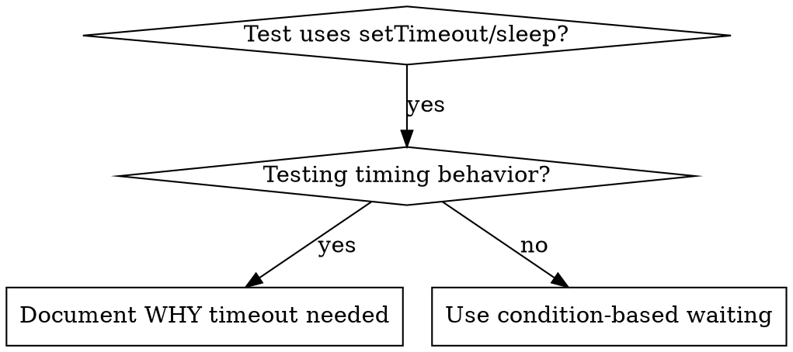

# Ожидание выполнения условия

## Обзор

Нестабильные тесты часто угадывают время ожидания, используя произвольные задержки. Это создаёт состояния гонки: тесты проходят на быстрых компьютерах, но падают под нагрузкой или в CI.

**Главный принцип:** ожидай фактического выполнения нужного условия, а не предполагаемого времени его достижения.

## Когда применять



**Применяй, когда:**
- В тестах есть произвольные задержки (`setTimeout`, `sleep`, `time.sleep()`)
- Тесты нестабильны: иногда проходят, но падают под нагрузкой.
- При параллельном запуске тесты превышают время ожидания.
- Нужно дождаться завершения асинхронных операций.

**Не применяй, когда:**
- Проверяется именно поведение во времени: debounce, интервалы throttle.
- Если используешь произвольный таймаут, всегда документируй ПОЧЕМУ.

## Основной подход

```typescript
// ❌ ДО: предполагаем длительность
await new Promise(r => setTimeout(r, 50));
const result = getResult();
expect(result).toBeDefined();

// ✅ ПОСЛЕ: ожидаем условие
await waitFor(() => getResult() !== undefined);
const result = getResult();
expect(result).toBeDefined();
```

## Краткие примеры

| Сценарий | Приём |
|----------|---------|
| Ожидание события | `waitFor(() => events.find(e => e.type === 'DONE'))` |
| Ожидание состояния | `waitFor(() => machine.state === 'ready')` |
| Ожидание количества | `waitFor(() => items.length >= 5)` |
| Ожидание файла | `waitFor(() => fs.existsSync(path))` |
| Сложное условие | `waitFor(() => obj.ready && obj.value > 10)` |

## Реализация

Общая функция периодической проверки:
```typescript
async function waitFor<T>(
  condition: () => T | undefined | null | false,
  description: string,
  timeoutMs = 5000
): Promise<T> {
  const startTime = Date.now();

  while (true) {
    const result = condition();
    if (result) return result;

    if (Date.now() - startTime > timeoutMs) {
      throw new Error(`Timeout waiting for ${description} after ${timeoutMs}ms`);
    }

    await new Promise(r => setTimeout(r, 10)); // Проверять каждые 10 мс
  }
}
```

Полную реализацию с функциями для предметной области (`waitForEvent`, `waitForEventCount`, `waitForEventMatch`) из реальной отладки см. в файле `condition-based-waiting-example.ts` этого каталога.

## Типичные ошибки

**❌ Слишком частая проверка:** `setTimeout(check, 1)` расходует ресурсы процессора.
**✅ Исправление:** проверяй каждые 10 мс.

**❌ Нет таймаута:** цикл бесконечен, если условие не выполняется.
**✅ Исправление:** всегда задавай таймаут и понятную ошибку.

**❌ Устаревшие данные:** состояние сохранено до цикла.
**✅ Исправление:** вызывай функцию получения внутри цикла.

## Когда фиксированная задержка оправданна

```typescript
// Инструмент срабатывает каждые 100 мс; для проверки частичного вывода нужны два срабатывания
await waitForEvent(manager, 'TOOL_STARTED'); // Сначала дождаться условия
await new Promise(r => setTimeout(r, 200));   // Затем подождать временное поведение
// 200 мс = 2 срабатывания с интервалом 100 мс: объяснено и обоснованно
```

**Требования:**
1. Сначала дождись запускающего условия.
2. Основывай задержку на известном времени, а не догадках.
3. Объясни в комментарии ПОЧЕМУ.

## Результат в реальном случае

По результатам отладки 03.10.2025:
- Исправлены 15 нестабильных тестов в трёх файлах.
- Доля прохождения: 60% → 100%.
- Время выполнения сократилось на 40%.
- Состояния гонки устранены.
