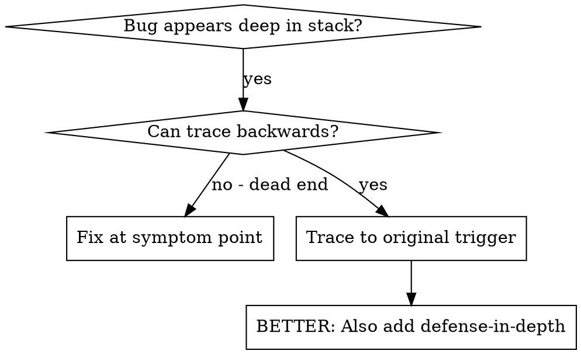
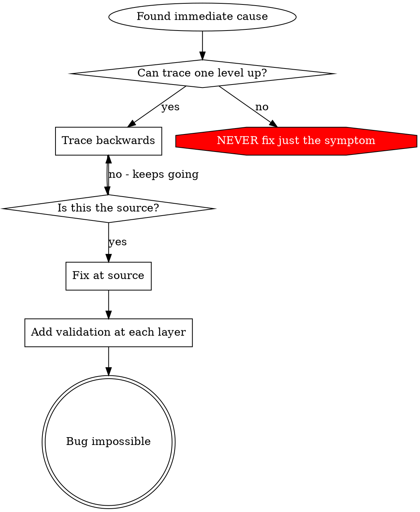

# Трассировка первопричины

## Обзор

Ошибки часто проявляются глубоко в стеке вызовов: git init выполняется не в том каталоге, файл создаётся не там, база открывается по неверному пути. Исправление в месте проявления устраняет лишь симптом.

**Главный принцип:** двигайся назад по цепочке вызовов до исходного триггера и исправляй проблему в источнике.

## Когда применять



**Применяй, когда:**
- Ошибка возникает глубоко в процессе выполнения, а не на входе.
- Трассировка показывает длинную цепочку вызовов.
- Непонятно, откуда взялись неверные данные.
- Нужно найти тест или код, вызывающий проблему.

## Процесс трассировки

### 1. Изучи симптом
```
Error: git init failed in ~/project/packages/core
```

### 2. Найди непосредственную причину
**Какой код непосредственно вызывает проблему?**
```typescript
await execFileAsync('git', ['init'], { cwd: projectDir });
```

### 3. Спроси: кто это вызвал?
```typescript
WorktreeManager.createSessionWorktree(projectDir, sessionId)
  → called by Session.initializeWorkspace()
  → called by Session.create()
  → called by test at Project.create()
```

### 4. Продолжай двигаться вверх по цепочке
**Какое значение передано?**
- `projectDir = ''` — пустая строка!
- Пустая строка в `cwd` приводит к использованию `process.cwd()`.
- Это каталог исходного кода!

### 5. Найди исходный триггер
**Откуда взялась пустая строка?**
```typescript
const context = setupCoreTest(); // Returns { tempDir: '' }
Project.create('name', context.tempDir); // Accessed before beforeEach!
```

## Добавление трассировки стека

Если вручную проследить не удаётся, добавь диагностику:

```typescript
// Перед проблемной операцией
async function gitInit(directory: string) {
  const stack = new Error().stack;
  console.error('DEBUG git init:', {
    directory,
    cwd: process.cwd(),
    nodeEnv: process.env.NODE_ENV,
    stack,
  });

  await execFileAsync('git', ['init'], { cwd: directory });
}
```

**Важно:** в тестах используй `console.error()`, а не logger: его вывод может скрываться.

**Запусти и сохрани вывод:**
```bash
npm test 2>&1 | grep 'DEBUG git init'
```

**Проанализируй трассировку:**
- Найди имена файлов тестов.
- Найди номер строки, запускающей вызов.
- Определи закономерность: один тест, одинаковый параметр?

## Поиск теста, загрязняющего окружение

Если проблема появляется при тестировании, но неизвестно, какой тест её вызывает:

Используй скрипт поиска `find-polluter.sh` в этом каталоге:

```bash
bash ./find-polluter.sh '.git' 'src/**/*.test.ts'
```

Он запускает тесты по одному и останавливается на первом нарушителе. Инструкции находятся в скрипте.

## Реальный пример: пустой projectDir

**Симптом:** `.git` создан в `packages/core/`, каталоге исходного кода.

**Цепочка поиска:**
1. `git init` выполняется в `process.cwd()` из-за пустого cwd.
2. WorktreeManager вызван с пустым projectDir.
3. Session.create() передал пустую строку.
4. Тест обратился к `context.tempDir` до beforeEach.
5. setupCoreTest() сначала возвращает `{ tempDir: '' }`.

**Первопричина:** инициализация переменной верхнего уровня обращалась к пустому значению.

**Исправление:** tempDir стал геттером, выдающим ошибку при обращении до beforeEach.

**Также добавлена многоуровневая защита:**
- Уровень 1: Project.create() проверяет каталог.
- Уровень 2: WorkspaceManager проверяет, что значение не пустое.
- Уровень 3: проверка NODE_ENV запрещает git init вне tmpdir.
- Уровень 4: запись стека вызовов перед git init.

## Основной принцип



**НИКОГДА не исправляй только место проявления ошибки.** Проследи цепочку до исходного триггера.

## Советы по трассировке

**В тестах:** используй `console.error()`, а не logger: его вывод может скрываться.
**До операции:** записывай сведения перед опасной операцией, а не после сбоя.
**Учитывай контекст:** каталог, cwd, переменные окружения, время. Не записывай секреты.
**Сохрани стек:** `new Error().stack` показывает всю цепочку вызовов.

## Результат в реальном случае

По результатам отладки 03.10.2025:
- Первопричина найдена по цепочке из пяти уровней.
- Исправление внесено в источник — проверку геттера.
- Добавлены четыре уровня защиты.
- Прошли 1847 тестов без загрязнения окружения.
