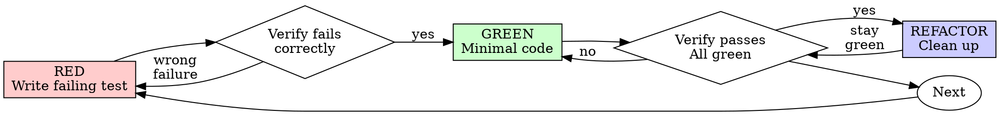

# Разработка через тестирование (TDD)

## Приоритет правил проекта

В проектах Валерия правила СУИИР имеют приоритет над этим навыком. Сохраняй существующий рабочий код и не удаляй результаты работы пользователя без его явного разрешения. Если указание ниже требует удалить код и противоречит правилам проекта или поручению пользователя, следуй СУИИР и запросу пользователя; укажи расхождение. Объём проверок выбирай по правилам проекта и условиям задачи.

## Обзор

Сначала напиши тест. Убедись, что он падает. Напиши минимум кода, чтобы он прошёл.

**Главный принцип:** если ты не видел, как тест падает, ты не знаешь, проверяет ли он нужное поведение.

**Нарушение буквы правил нарушает и их смысл.**

## Когда применять

**Всегда:**
- Новые функции.
- Исправление ошибок.
- Рефакторинг.
- Изменение поведения.

**Исключения, которые исходный навык предлагает согласовать с пользователем:**
- Одноразовые прототипы.
- Сгенерированный код.
- Файлы конфигурации.

Думаешь «пропущу TDD только в этот раз»? Остановись: это оправдание.

## Непреложное правило

```text
НИКАКОГО PRODUCTION-КОДА БЕЗ ПРЕДВАРИТЕЛЬНОГО ПАДАЮЩЕГО ТЕСТА
```

В оригинальной методике код, написанный до теста, предлагается удалить и начать заново. **Приоритет СУИИР:** существующий код и результаты пользователя не удаляй без явного разрешения; при конфликте предложи безопасный способ проверить поведение.

В исходном процессе не допускаются исключения: нельзя оставить код как «образец», адаптировать его при написании тестов или смотреть на него. Удаление означает удаление. Реализация пишется заново по тестам. Применяй это только в пределах приоритета выше.

## Red–Green–Refactor



### RED — напиши падающий тест

Напиши один минимальный тест, показывающий ожидаемое поведение.

<Good>
```typescript
test('retries failed operations 3 times', async () => {
  let attempts = 0;
  const operation = () => {
    attempts++;
    if (attempts < 3) throw new Error('fail');
    return 'success';
  };

  const result = await retryOperation(operation);

  expect(result).toBe('success');
  expect(attempts).toBe(3);
});
```
Ясное название, проверка реального поведения и одного условия.
</Good>

<Bad>
```typescript
test('retry works', async () => {
  const mock = jest.fn()
    .mockRejectedValueOnce(new Error())
    .mockRejectedValueOnce(new Error())
    .mockResolvedValueOnce('success');
  await retryOperation(mock);
  expect(mock).toHaveBeenCalledTimes(3);
});
```
Неясное название, проверяется имитация вместо поведения кода.
</Bad>

**Требования:**
- Одно поведение.
- Понятное название.
- Реальный код; имитации — только когда без них нельзя.

### Проверь RED — увидь падение теста

**ОБЯЗАТЕЛЬНО. Не пропускай.**

```bash
npm test path/to/test.test.ts
```

Убедись, что тест именно не проходит, а не завершается ошибкой запуска; сообщение соответствует ожиданиям; причина падения — отсутствие функции, а не опечатка.

**Тест проходит?** Он проверяет существующее поведение. Исправь тест.

**Ошибка запуска?** Исправь её и перезапускай, пока тест не упадёт по правильной причине.

### GREEN — минимум кода

Напиши простейшую реализацию, достаточную для прохождения теста.

<Good>
```typescript
async function retryOperation<T>(fn: () => Promise<T>): Promise<T> {
  for (let i = 0; i < 3; i++) {
    try {
      return await fn();
    } catch (e) {
      if (i === 2) throw e;
    }
  }
  throw new Error('unreachable');
}
```
Только то, что нужно для прохождения.
</Good>

<Bad>
```typescript
async function retryOperation<T>(
  fn: () => Promise<T>,
  options?: {
    maxRetries?: number;
    backoff?: 'linear' | 'exponential';
    onRetry?: (attempt: number) => void;
  }
): Promise<T> {
  // YAGNI
}
```
Избыточное усложнение.
</Bad>

Не добавляй функции, не перерабатывай другой код и не делай улучшения сверх требований теста.

### Проверь GREEN — увидь успешное прохождение

**ОБЯЗАТЕЛЬНО.**

```bash
npm test path/to/test.test.ts
```

Убедись, что тест проходит, остальные тесты проходят, а в выводе нет ошибок и предупреждений.

**Тест не проходит?** Исправь код, а не тест.

**Другие тесты не проходят?** Исправь сейчас.

**«Другие тесты» — это набор проекта, а не только твой файл.** Успешный запуск отдельного теста не означает, что проходит весь набор. Прежде чем объявить работу завершённой, запусти принятую в проекте команду тестов: `pytest`, `npm test`, `cargo test` или другую, даже если задача называла один файл. Границы задачи ограничивают результат, а не проверку. Укажи в отчёте поимённо любые обнаруженные сбои, даже если вызвал их не ты: умолчание об увиденной ошибке искажает отчёт.

### REFACTOR — приведи код в порядок

Только после успешных тестов:
- Удали дублирование.
- Улучши названия.
- Вынеси вспомогательные функции.

Тесты должны оставаться успешными. Не добавляй нового поведения.

### Повтори

Напиши следующий падающий тест для следующей функции.

## Хорошие тесты

| Качество | Хорошо | Плохо |
|---|---|---|
| **Минимальный** | Проверяет одно. Есть «и» в названии? Раздели. | `test('validates email and domain and whitespace')` |
| **Понятный** | Название описывает поведение | `test('test1')` |
| **Показывает намерение** | Демонстрирует желаемый API | Скрывает ожидаемое поведение |

При написании или изменении теста прочитай [writing-good-tests.md](writing-good-tests.md). Основные правила:
- До написания назови изменение production-кода, которое заставит тест упасть.
- Проверяй реальное поведение, а не поведение имитаций.
- Держи вспомогательный тестовый код в тестовых утилитах, а не в production-классах.
- До подмены зависимости изучи её побочные эффекты.

## Типичные оправдания

| Оправдание | Реальность |
|---|---|
| «Слишком просто для теста» | Простой код тоже ломается; тест занимает немного времени. |
| «Протестирую потом» | Написанный после реализации тест сразу проходит, что ничего не доказывает: он может проверять неверное поведение, повторять реализацию или пропустить крайний случай. Падение теста сначала показывает, что он способен обнаружить ошибку. |
| «Тесты после достигают той же цели; важен смысл» | Тест после отвечает «что это делает?», а тест до — «что должно делать?». Написанный после тест зависит от уже созданного кода и проверяет вспомненные случаи, не доказывая собственной эффективности. |
| «Я уже проверил вручную» | Ручная проверка не оставляет полного воспроизводимого набора и легко пропускает случаи. Автоматический тест повторяется одинаково. |
| «Удалить X часов работы расточительно» | Это ошибка невозвратных затрат: время уже потрачено. Исходная методика предлагает выбрать TDD вместо ненадёжного добавления тестов впоследствии. Соблюдай ограничения на удаление выше. |
| «Оставлю как образец и сначала напишу тесты» | Возникает соблазн адаптировать код: это тестирование после реализации. |
| «Сначала нужно исследовать» | Можно исследовать; по исходной методике одноразовый результат затем отбрасывается и работа начинается с TDD. Соблюдай ограничения на удаление выше. |
| «Сложно тестировать — значит, проектирование неясно» | Прислушайся к тесту: сложность тестирования может означать сложность использования. |
| «TDD замедлит меня» | TDD помогает обнаружить ошибки до коммита, предотвратить регрессии и безопасно менять код. |
| «Руками быстрее» | Ручная проверка не доказывает крайние случаи, её придётся повторять после изменений. |
| «В существующем коде нет тестов» | Улучши его, добавив тесты для существующего поведения. |

## Тревожные признаки — ОСТАНОВИСЬ

- Код написан до теста.
- Тест написан после реализации.
- Тест сразу проходит.
- Не можешь объяснить причину падения.
- Тесты откладываются на потом.
- Ищешь оправдание «только в этот раз».
- «Я уже проверил вручную».
- «Тесты после решают ту же задачу».
- «Важен смысл, а не ритуал».
- «Оставлю как образец» или «адаптирую существующий код».
- «Я потратил X часов, удалять жалко».
- «TDD догматичен, а я практичен».
- «Здесь другой случай, потому что…».

В исходной методике все эти признаки означают начать цикл TDD заново. Соблюдай приоритет СУИИР и не удаляй код без необходимого разрешения.

## Пример исправления ошибки

**Ошибка:** пустой email принимается.

**RED**
```typescript
test('rejects empty email', async () => {
  const result = await submitForm({ email: '' });
  expect(result.error).toBe('Email required');
});
```

**Проверка RED**
```bash
$ npm test
FAIL: expected 'Email required', got undefined
```

**GREEN**
```typescript
function submitForm(data: FormData) {
  if (!data.email?.trim()) {
    return { error: 'Email required' };
  }
  // ...
}
```

**Проверка GREEN**
```bash
$ npm test
PASS
```

**REFACTOR:** при необходимости вынеси проверку нескольких полей.

## Контрольный список

Перед завершением:

- [ ] Для каждой новой функции или метода есть тест.
- [ ] Видел, как каждый тест падает до реализации.
- [ ] Каждый тест упал по ожидаемой причине — отсутствует функция, а не допущена опечатка.
- [ ] Для каждого теста написан минимальный код.
- [ ] Все тесты проходят.
- [ ] В выводе нет ошибок и предупреждений.
- [ ] Тесты используют реальный код; имитации только при необходимости.
- [ ] Крайние случаи и ошибки покрыты.

Если не все пункты выполнены, исходный процесс TDD не соблюдён; сообщи об этом и действуй в пределах правил проекта.

## Если застрял

| Проблема | Решение |
|---|---|
| Не знаешь, как тестировать | Запиши желаемый API и сначала напиши проверку результата; спроси пользователя. |
| Тест слишком сложный | Возможно, сложен дизайн. Упрости интерфейс. |
| Приходится подменять всё | Код слишком связан. Используй внедрение зависимостей. |
| Подготовка теста огромна | Вынеси вспомогательные функции. Всё ещё сложно? Упрости дизайн. |

## Связь с отладкой

Нашёл ошибку? Напиши падающий тест, который её воспроизводит. Следуй циклу TDD: тест подтверждает исправление и предотвращает регрессию.

Не исправляй ошибки без теста.

## Итоговое правило

```text
Production-код → тест существует и сначала упал
Иначе → это не TDD
```

Исходный навык требует разрешения пользователя для исключений. Применяй его с учётом правил проекта и оговорённого выше приоритета СУИИР.
