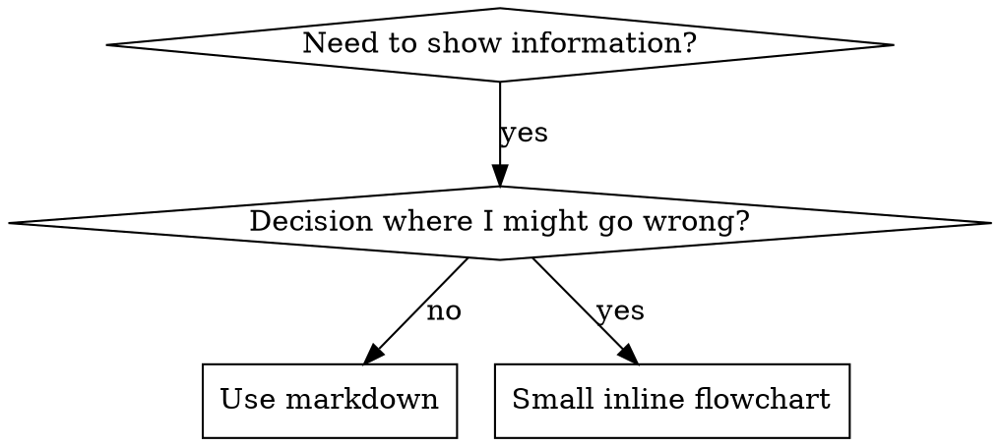

# Блок-схемы в навыках

Часть superpowers:writing-skills.

## Применение блок-схем



**Используй блок-схемы ТОЛЬКО для:**
- Неочевидных точек принятия решений.
- Циклов процесса, которые можно закончить слишком рано.
- Выбора, когда использовать A или B.

**Не используй блок-схемы для:**
- Справочных материалов → используй таблицы и списки.
- Примеров кода → используй блоки Markdown.
- Последовательных инструкций → используй нумерованные списки.
- Названий без смыслового значения, например step1, helper2.

Правила оформления Graphviz см. в `graphviz-conventions.dot` этого каталога.

**Показ пользователю:** чтобы преобразовать блок-схемы навыка в SVG, запусти `render-graphs.js` из каталога writing-skills:
```bash
node ./render-graphs.js ../some-skill           # Каждая схема отдельно
node ./render-graphs.js ../some-skill --combine # Все схемы в одном SVG
```
